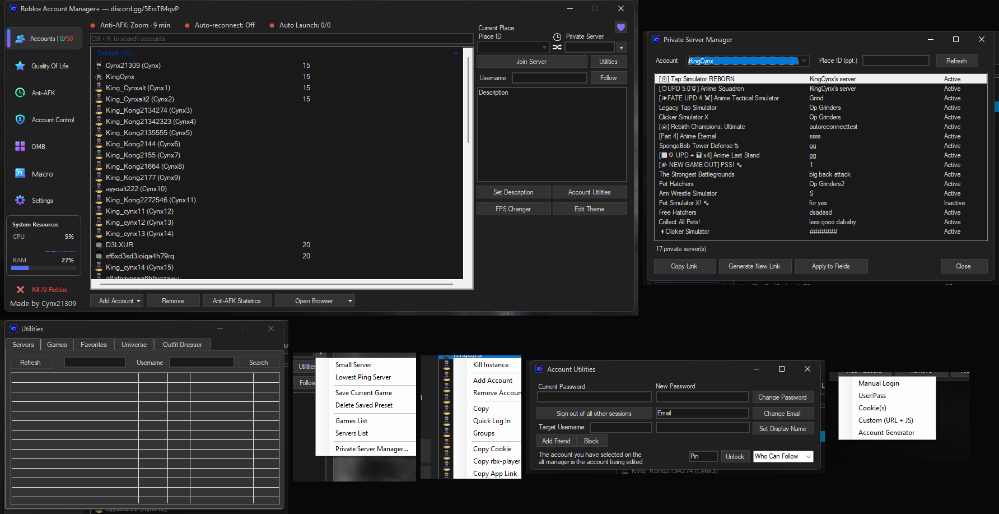
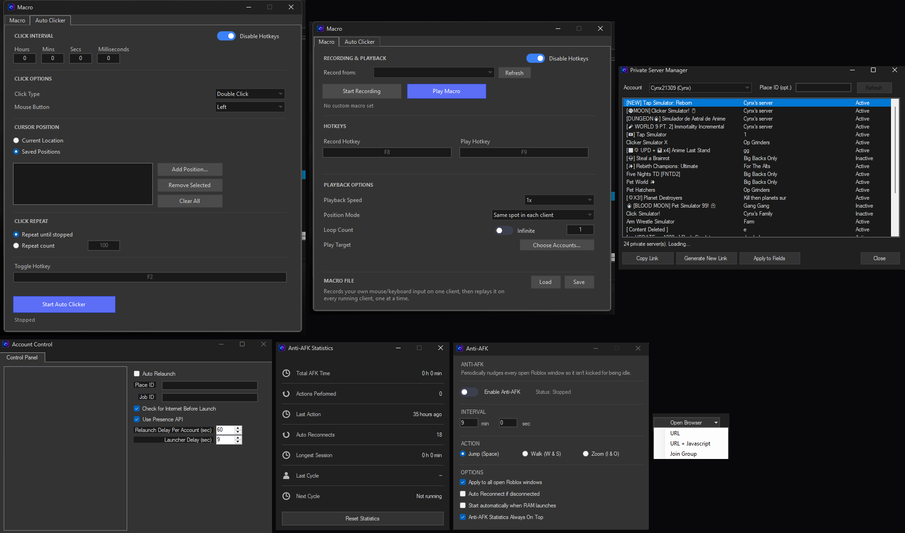
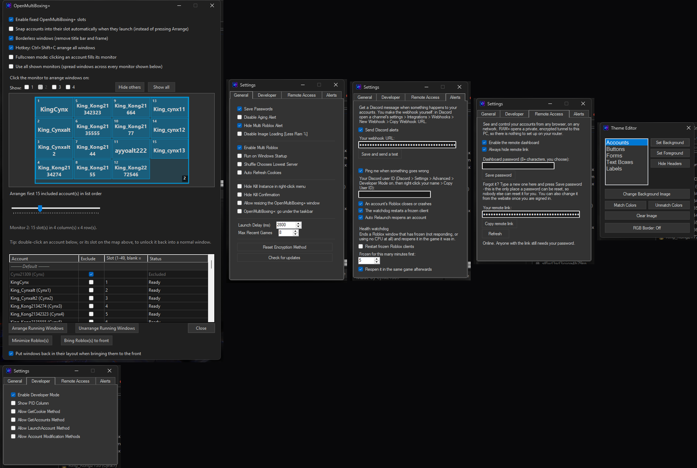
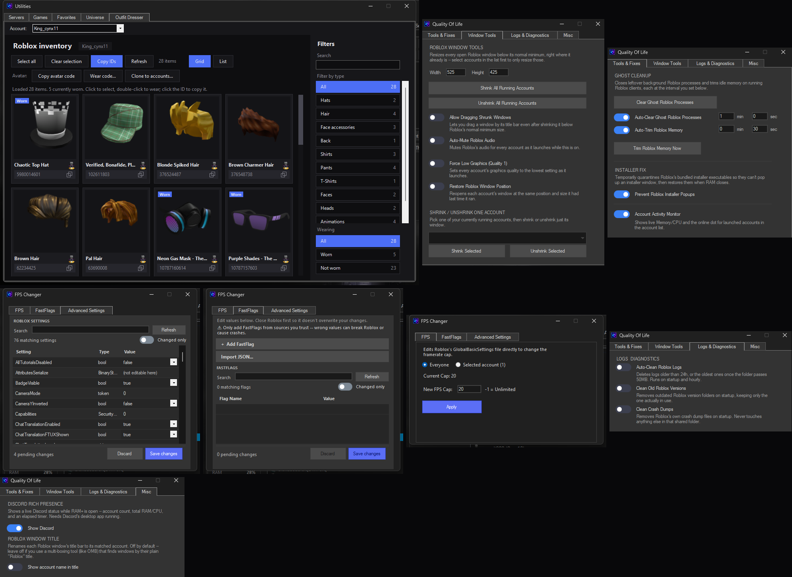
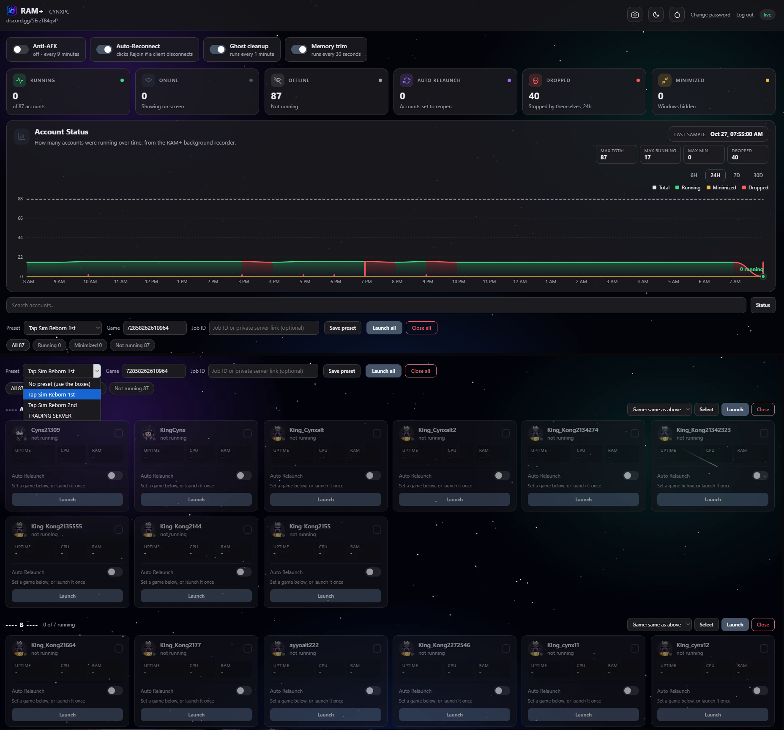
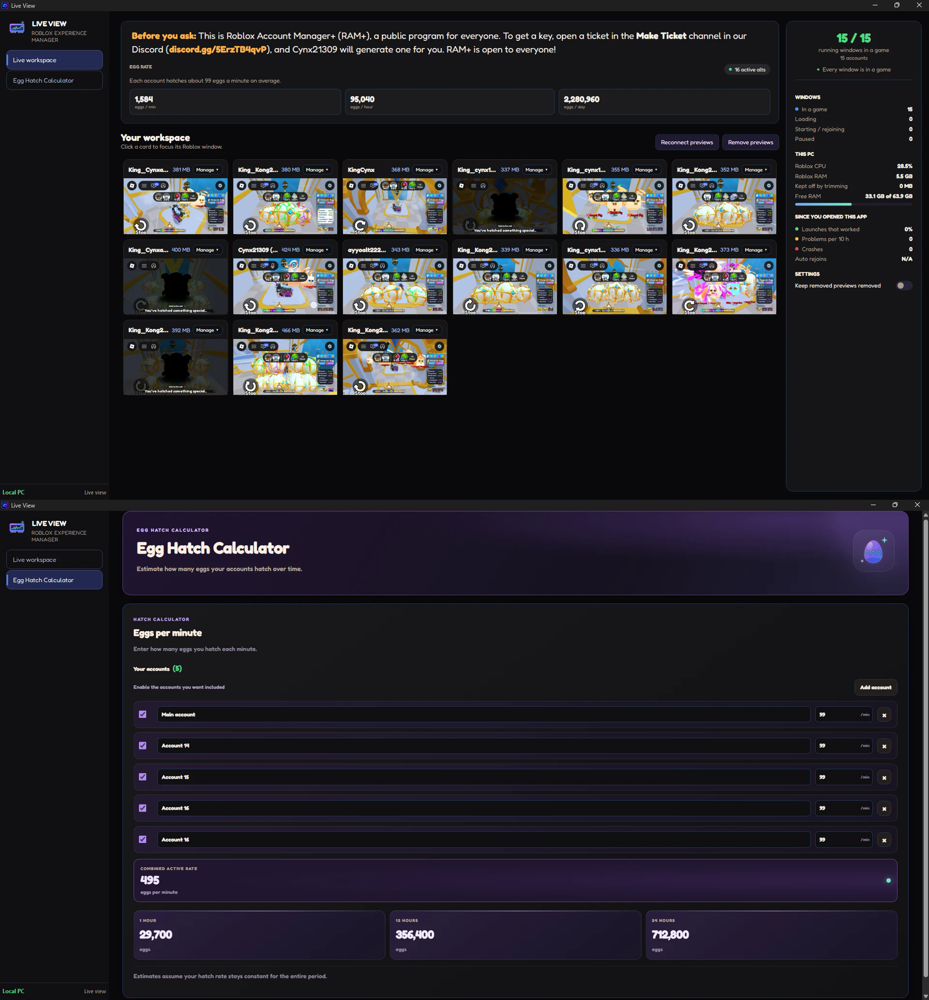

# 👑 Roblox Account Manager+

### **Manage and run a bunch of Roblox accounts from one place.**
*Launch any account into any game, keep it alive while you're away, watch its resource usage, and skin the whole thing to look how you want.*

  
  
  
  

[🖼️ Screenshots](#-screenshots) • [✨ Features](#features) • [📊 Comparison](#-ram-vs-the-original-vs-other-basic-managers) • [🔑 Getting a Key](#-getting-a-key) • [🚀 Getting Started](#-getting-started) • [🔒 Security](#-security-and-privacy) • [❓ FAQ](#-faq)

---

The download is **public**, but the app is **key only** — it won't open without a license key (see
[Getting a key](#-getting-a-key)). It's not open source and isn't accepting outside contributions;
this README is here so anyone with a key knows what the app actually does.

## 🖼️ Screenshots

Every window, tab, and menu in the app, grouped into six parts:

  

  

  

  

  

## ✨ Features

**Accounts**
- ➕ Add, group, launch, and manage any number of Roblox accounts from one list
- 📊 Live Memory/CPU usage and an online-in-game status dot per running account
- ⌨️ Ctrl+K search box to filter the account list instantly
- ✏️ Per-account description, alias, and display name editing
- ⏱️ Uptime shown as `Xd Xh Xm Xs` once an account's been running 24h+
- 🤖 **Account Generator** (Add Account -> Account Generator) — fills in Roblox's sign-up page and presses Sign Up
  while **you solve each CAPTCHA by hand**; the account is then saved to RAM+ with its password
- 🎛️ Drag accounts into **Account Control** to manage them from a separate panel, grouped like the main list

**Launching**
- 🎮 Launch into a Place ID, a specific server (job ID), or a private server/share link
- ✅ Tick several accounts to launch them one after another
- 💾 Saved game/server presets so you don't have to re-paste the same link every time
- 🌐 Server browser with player counts, and a Follow-a-player option
- 🪟 **Restore Window Position** — puts each account's window back exactly where it was last time

**Anti-AFK**
- 💤 Its own sidebar section, reliable across every open window, with automatic retries
- 🔌 Auto Reconnect — clicks through Roblox's own disconnect dialog if a client gets kicked
- 📈 **Anti-AFK Statistics** window — total AFK time, actions performed, auto-reconnects, longest session, live "next cycle" countdown

**Macro Playback & Auto Clicker**
- 🔴 Record your own mouse and keyboard input on one account, then play it back across every other
  running account using real input injection — not a screen-position guess
- 🖱️ A GS Auto Clicker-style repeater that cycles through a whole list of saved positions

**Quality of Life**
- 👻 Ghost process cleanup, memory trimming, installer popup prevention
- 🪟 Window shrink/resize tools, auto-mute audio, force low graphics, window position restore
- 🧹 Auto-clean old logs, remove outdated Roblox versions, clean crash dumps
- 🎙️ Discord Rich Presence while the app is open
- 🎚️ Global FPS cap or a per-account override, plus a FastFlags editor and an Advanced Settings tab —
  all written straight into Roblox's own files
- 📺 Optional RAM/CPU/Time overlay on each Roblox window
- 📊 A live System Resources card for the whole app, right in the sidebar

**OpenMultiBoxing+**
- 🧩 Built-in multiboxing — each account gets a fixed slot and its window snaps there the instant it launches
- 🔢 Auto grid layout, up to 49 slots; click a monitor on the built-in map to arrange windows there
- 🔀 Drag slots to swap accounts, or type a slot number to insert one — **Exclude** drops an account from
  the rotation without deleting it (handy for keeping your main out while alts still arrange)
- 🪄 Its own window, independent of the main one

**Theming**
- 🎨 Full Theme Editor — colors, borders, and backgrounds for every part of the UI
- 🖼️ Custom background image, **Match Colors** auto-recolor from it, animated RGB border

**Utilities**
- 🔎 Browse Games, Private Server Manager, Account Control, Account Utilities
- 👕 **Outfit Dresser** — browse an account's inventory, double-click an item to wear or unwear it, or
  share a full outfit via code

**Remote Dashboard**
- 📱 A password-protected website built into RAM+: live account tiles, stat cards and a history chart,
  launch/close per account or for everything, and a shareable link that works from any network
  through a free Cloudflare tunnel — no port forwarding

## 📊 RAM+ vs. the Original vs. Other Basic Managers

RAM+ started as a fork of the original Roblox Account Manager and kept building from there. The **RAM+** and
**Original RAM** columns are based on each project's own README, not a full code audit of either.
**Other Basic Managers** is a generic stand-in for the bare-bones alt managers floating around — add/launch
accounts and not much else. Not a knock on the original — it's a solid base and still actively maintained —
just what's different here.

<!-- Badge cells render as colored pills inside the table on GitHub -->
[yes]: https://img.shields.io/badge/-Yes-2ecc71?style=flat-square
[no]: https://img.shields.io/badge/-No-e74c3c?style=flat-square

| Feature | 👑 **RAM+** | 🐺 **Original RAM** | 📦 **Other Basic Managers** |
|---|:---:|:---:|:---:|
| Add, launch, and manage multiple accounts | ![Yes][yes] | ![Yes][yes] | ![Yes][yes] |
| Cookie import (bulk, one per line) | ![Yes][yes] | ![Yes][yes] | ![Yes][yes] |
| Bulk import via username:password | ![Yes][yes] | ![Yes][yes] | ![No][no] |
| Drag-to-sort accounts | ![Yes][yes] | ![Yes][yes] | ![No][no] |
| Account grouping | ![Yes][yes] | ![Yes][yes] | ![No][no] |
| **Custom group ordering** (type any name) | ![Yes][yes] | ![No][no] — needs `1Main`, `007 Bank`-style prefixes | ![No][no] |
| **Live Memory/CPU per account** | ![Yes][yes] | ![No][no] | ![No][no] |
| **Online-in-game status dot** | ![Yes][yes] | ![No][no] | ![No][no] |
| **Ctrl+K account search** | ![Yes][yes] | ![No][no] | ![No][no] |
| **Per-account window position/size restore** | ![Yes][yes] | ![No][no] | ![No][no] |
| **Built-in multiboxing grid (OpenMultiBoxing+)** | ![Yes][yes] | ![No][no] | ![No][no] — usually needs a separate third-party tool |
| **Live View** — real live video preview of every running account's window in one place | ![Yes][yes] | ![No][no] | ![No][no] |
| **Egg Hatch Calculator** — combined eggs/min, /hour, /day across multiple accounts | ![Yes][yes] | ![No][no] | ![No][no] |
| **Macro Playback** — record & replay real input across accounts | ![Yes][yes] | ![No][no] | ![No][no] |
| **Auto Clicker** — repeating clicker, cycles through saved positions | ![Yes][yes] | ![No][no] | ![No][no] |
| Launch into a Place ID / server / VIP link | ![Yes][yes] | ![Yes][yes] | ![Yes][yes] |
| Saved game/server presets | ![Yes][yes] | ![Yes][yes] | ![No][no] |
| Server browser with player counts | ![Yes][yes] | ![Yes][yes] | ![No][no] |
| **Lowest Ping Server** — one-click preset | ![Yes][yes] | ![No][no] — manual, sort the server list yourself | ![No][no] |
| Shuffle JobId | ![Yes][yes] | ![Yes][yes] | ![No][no] |
| **Anti-AFK** (keeps a session alive while idle) | ![Yes][yes] | ![No][no] — not in their feature list | ![No][no] |
| Reconnect/relaunch after getting kicked | ![Yes][yes] — clicks through the rejoin dialog directly | ![Yes][yes] — "Auto Relaunch," closes and reopens the whole client instead | ![No][no] |
| **Anti-AFK Statistics window** | ![Yes][yes] | ![No][no] | ![No][no] |
| FPS unlock | ![Yes][yes] | ![No][no] — documented, but doesn't actually work | ![No][no] |
| **Per-account FPS override** | ![Yes][yes] | ![No][no] — global only | ![No][no] |
| **FastFlags editor** — add/edit FastFlags, auto-reapplied before every launch | ![Yes][yes] | ![No][no] | ![No][no] |
| **Discord Rich Presence** | ![Yes][yes] | ![No][no] | ![No][no] |
| Local HTTP API | ![Yes][yes] | ![Yes][yes] | ![No][no] |
| **Per-account RAM/CPU/time overlay** | ![Yes][yes] | ![No][no] | ![No][no] |
| **System Resources sidebar card** — live CPU/RAM for the whole app | ![Yes][yes] | ![No][no] | ![No][no] |
| **Ghost process cleanup / memory trimming** | ![Yes][yes] | ![No][no] | ![No][no] |
| Theme editor | ![Yes][yes] | ![Yes][yes] — basic, "not much I can do about it with WinForms" by their own README | ![No][no] |
| **Auto-recolor from a background image** | ![Yes][yes] | ![No][no] | ![No][no] |
| **Animated RGB window border** | ![Yes][yes] | ![No][no] | ![No][no] |

## 🔑 Getting a Key

Release builds require a key before the app opens at all. Keys are issued by the owner and bound to
one device the first time they're used — make a ticket on Discord if you don't have one.

Once activated, the title bar shows how much time is left on your key.

## 🚀 Getting Started

1️⃣ Get the exe and a license key (see above).
2️⃣ Run it, enter your key and Discord username, and choose **Add account**.

### Adding an account

- 🔹 **Browser** (recommended) opens Roblox's own login page in a real, separate browser window. Sign in
  as usual — captchas and 2-step verification just work, and your password never passes through the app.
- 🔹 **Password** signs in through Roblox's login service directly (user:pass, one per line for bulk adds).
  Quick, but if Roblox throws a captcha at it you'll need Browser instead.
- 🔹 **Cookie** takes a `.ROBLOSECURITY` value you already have — paste one per line to bulk-import.

### Launching

Select an account, paste a **Place ID or game link**, and press **Launch**. Add a server ID or a
private server link to join a specific server.

## 🔒 Security and Privacy

Session cookies are the keys to your accounts, so the app treats them that way.

- 🔐 **Encrypted at rest**, password-protected on first run.
- 🚫 **No telemetry, no external server.** The app talks to Roblox's own API, to GitHub for the app's own
  updates, and to Discord only if a webhook is configured for release announcements.
- 🔑 **Access is key-gated**, and every key is bound to one device.

## 📝 Changelog

See the [Releases page](../../releases) for what changed in each version.

## ❓ FAQ

<b>Where do my cookies go?</b>

Nowhere but your own disk, encrypted, and Roblox's official endpoints when the app checks a session
or launches a game — the same as your browser does.

<b>Can I run more than one Roblox client at once?</b>

Yes, that's the whole point — launch as many accounts as you want side by side.

<b>Is there an auto-updater?</b>

Yes — RAM+ checks for a new version on startup and asks Yes/No before downloading and installing it.
Nothing updates without your say-so.

<b>Does this break Roblox's Terms of Service?</b>

The app does what you could do by hand in a browser: sign in and launch games, through official
endpoints. Automation features (Anti-AFK, etc.) are a grey area, so use them responsibly and at your
own risk.

 

Not affiliated with Roblox Corporation. You are responsible for your own accounts.

